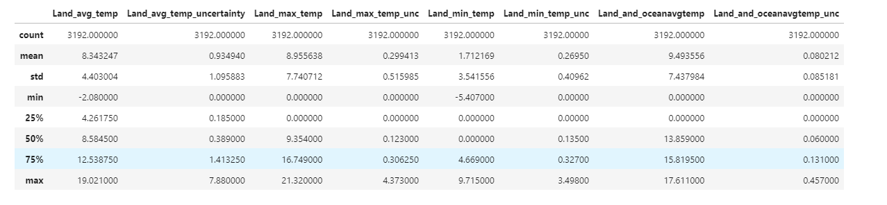
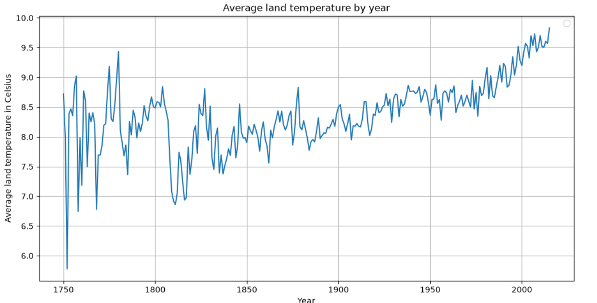
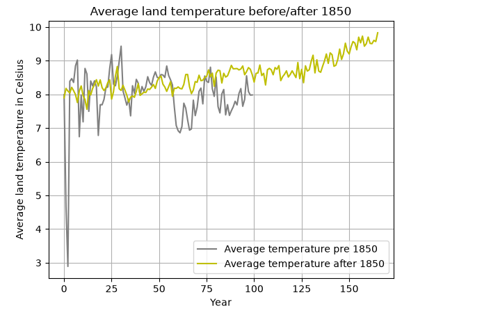
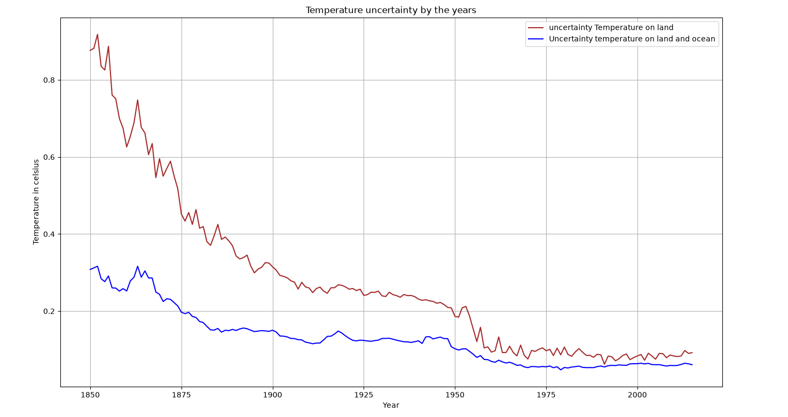
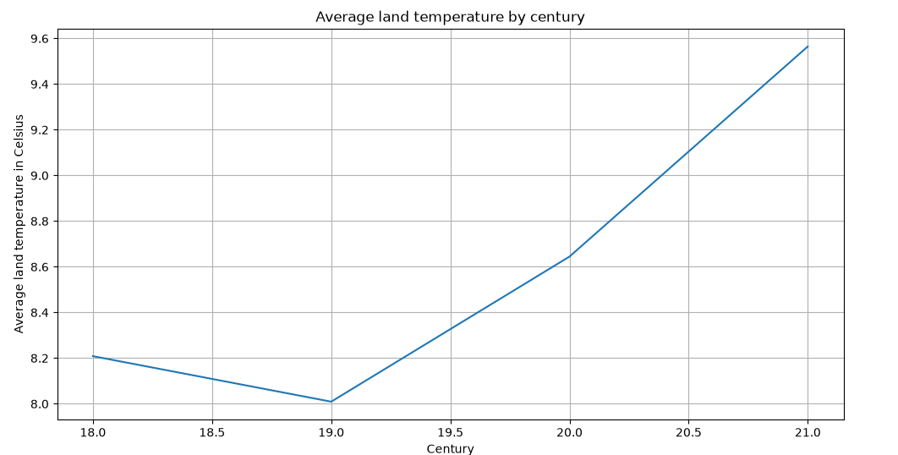
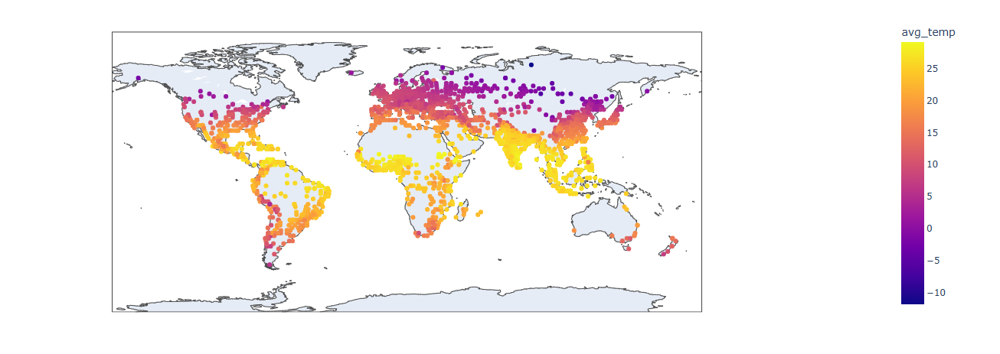
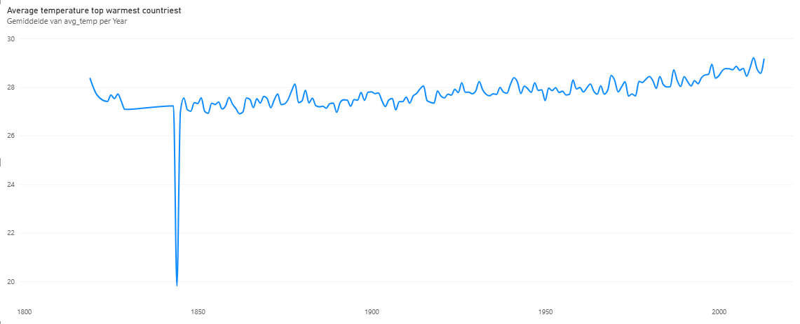
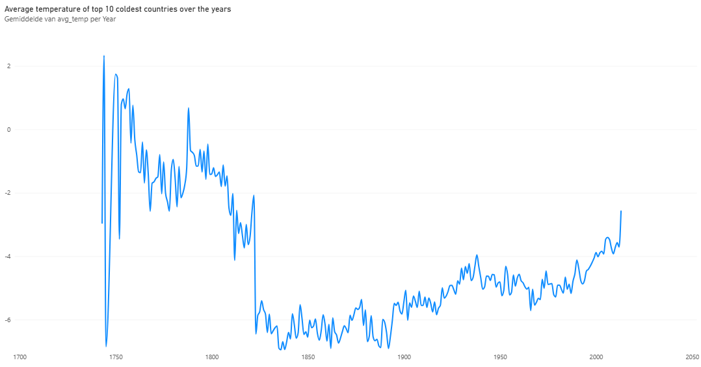
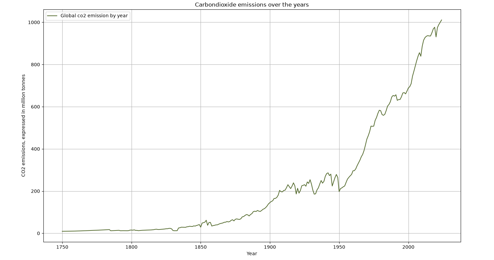

Report and analysis of the case: Climate watch   Author: Sander van Dam   Date: 05/11/2026  
# Report of global temperatures
The goal of the case was to analyze trends in global temperature changes over time and to visualise this data using tools like python, Jupyter Notebook, SQL and MS Power BI. The case was analyzed by importing the provided csv files into an SQL Database using MySQL. Empty values were transformed into NULL (or NaN in python) to prevent unforeseen skewing in the dataset if data were to be transformed into 0. Additionally, a subset of the data was created using all entries from 1980 onward.
## Average temperature shifts
For the global temperature on land and sea a table was made to inspect the global statistics of temperature with the following results:
  Figure 1: Descriptives table
  

This table describes the basic information of the dataset but cannot show many meaningful results. What can be observed in the table is the average global temperature throughout the entire database (from 1743 until 2015) and the standard deviation of this temperature. 
The next step was to analyze global temperature averages by year, first by descriptions in a table, then visualised as a line graph:
  Figure 2: Average temperature graph  
   
The above line graph inspects global land temperature trends throughout the years. The first point that stands out is a decreasing variety throughout the years. At the start of the graph at 1750 the lines are consistently far apart from each other, this would signify that global temperature was rapidly changing up and down around this time, sometimes even changing 2-2.5 degrees in only a couple of years. In later years the variety in temperature throughout the years reduces significantly. though this seems like a strange observation, temperature records before 1850 was analysed by so called "proxy-data". proxy data is measured by things as coral growth, ice cores, icotope variations and tree rings. temperature records before 1850 also had less coverage and consisted largely of measures in the northern hemisphere and were also read manually. Since 1850 the world developed more reliable ways to measure global temperature with globally distributed electronic sensors, mercury or alcohol thermometers. This change in methodology improved validity and reliability of global temperature measurements.  

To clarify the variety between pre 1850 and post 1850 trends the following comparison graph has been developed:
 Figure 3: Graph displaying average temperature on land pre-and post 1850
\   
This graph portrays the global average temperature from 1750 until 1850 and the temperature from 1850 until 2015. The comparison functions to investigate temperature differences before and after the new analysis methods. As seen in the graphs the temperature measured before 1850 shows greater variety than temperature measurmenets after. This will likely be the cause of inaccurate measurement equipment, both downward and upward trends show a high variety meaning that both max and min tempreatures were probably inaccurate. Since the methods have changed there has never been such great difference in yearly tempreature shift again. \
Even though before 1850 temperature measurements were not yet fully accurate, since 1850 measurements have not always been as accurate as well. Though to keep transparency about the provided data, scientist also developed an uncertainty rating to temperatures over the years. this number explains how certain scientist were about the temperatures they found.    these ratings are displayed below:    Figure 4: Temperature uncertainty graph
   
Though this information is interesting, the more important trend in the data is that there is a rapid increase in temperature to be seen throughout the years. Since 1800 the temperature has increased almost 2 degrees globally. To see this effect more clearly the graph below here has been created:
  Figure 5: Graph displaying the average temperature by century
 \
This graph provides a clearer image of the average temperature shift visualized by the average data over centuries instead of years. Temperature shifts have happened globally but what part of the world has been impacted the most is for now yet unclear. For this reason we need to analyze both the hottest and coldest regions of the world to get a clearer picture of the shifts. But before we visualise that we need to know what the temperature distribution is like globally.
## Temperatures around the globe
Figure 6: Global temperature distribution   
  
The figure above provides a map with the average temperatures by city across the world. As we know the warmest temperatures recorded are normally close to the equator while temperatures get colder closer to the poles of the earth. While the temperature by cities gives a broad overview of the temperature distribution, it lacks data on certain places like antartica and other places where temperature would be expected to be the lowest since these places are mostly uninhabited.    
Figure 7: average temperature of the 10 warmest countries   
  
Figure 8: Average temperature of the 10 coldest countries   
  
The graphs above display the average temperature of the 10 warmest and 10 coldest countries throughout the last centuries, according to the observation of these graphs it seems that especially in the coldest countries the temperature shift is significant. Since the coldest countries display a temperature increase of about 3 degrees. Though this temperature shift seems less apparent at the warmest countries there is still a change of about 2 degrees in average temperature. This increase in temperature is very concerning, especially for local ecosystems and the habitats of animals. The likely cause of this increase might have several reasons.
## The impact of CO2
One of the most importantly contributing factors of this climate change is the emission of greenhouse gases. The emission of greenhouse gases has said to have a very large impact on the global climate because these gases get trapped in the earths atmosphere and create a global warming effects by this. The biggest contributer of these gases is carbondioxide also known as CO2. To investigate the impact of Co2 emissions on the global temperature we first need to see what the levels of released CO2 looks like the last centuries:
Figure 9: CO2 emission per year (in million tonnes)  
  
As seen in this graph the global emission of CO2 has seen a rapid growth throughout the last 250 years. Especially since 1950 the growth has more than quadrupled from about 200 million tonnes to 1000 million tonnes per year. This proves a correlation between global co2 emissions and temperature risings.
